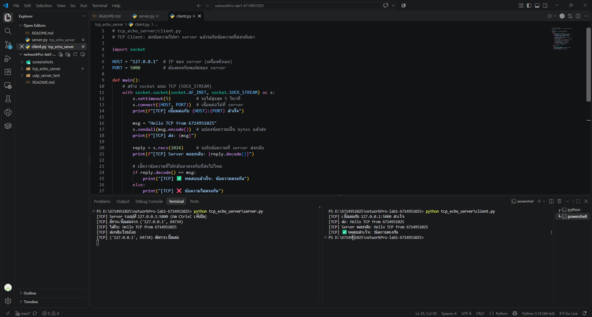
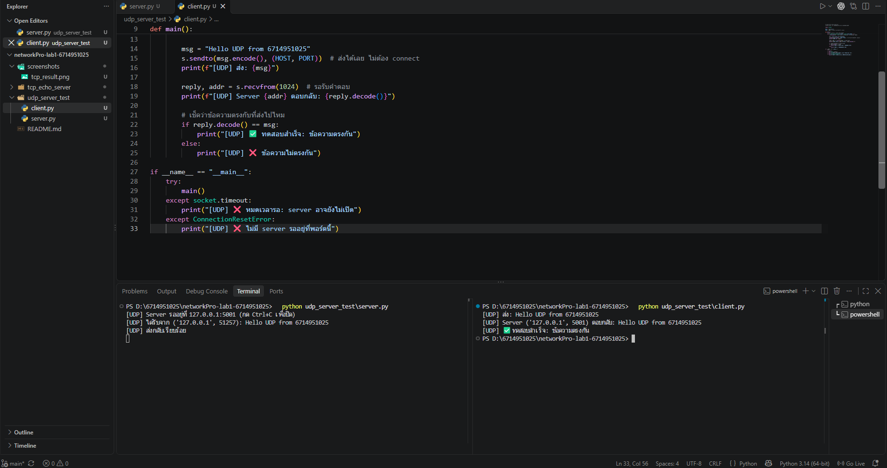

# networkPro-lab1-6714951025

Lab 1 – Network Programming: TCP Echo Server และ UDP Server Test ด้วย Python Socket

- **ผู้จัดทำ:** Nathakorn
- **รหัสนักศึกษา:** 6714951025

## โครงสร้าง Repository

```
networkPro-lab1-6714951025/
├── tcp_echo_server/
│   ├── server.py    # TCP Echo Server
│   └── client.py    # TCP Client
├── udp_server_test/
│   ├── server.py    # UDP Server
│   └── client.py    # UDP Client
├── screenshots/     # ภาพผลการทดสอบ
└── README.md
```

## วิธีดาวน์โหลดและรัน

**ความต้องการ:** Python 3 (ไม่ต้องติดตั้ง library เพิ่ม)

```bash
git clone https://github.com/6714951025/networkPro-lab1-6714951025.git
cd networkPro-lab1-6714951025
```

### ทดสอบ TCP (เปิด Terminal 2 หน้าต่าง)
```bash
# หน้าต่างที่ 1: เปิด server ก่อน
python tcp_echo_server/server.py

# หน้าต่างที่ 2: รัน client
python tcp_echo_server/client.py
```

### ทดสอบ UDP (เปิด Terminal 2 หน้าต่าง)
```bash
# หน้าต่างที่ 1: เปิด server ก่อน
python udp_server_test/server.py

# หน้าต่างที่ 2: รัน client
python udp_server_test/client.py
```

## ผลการทดสอบ

### TCP Echo Server (พอร์ต 5000)
Client ส่งข้อความ `Hello TCP from 6714951025` ไปที่ server และได้รับข้อความเดิมกลับมาครบถ้วน



### UDP Server Test (พอร์ต 5001)
Client ส่งข้อความ `Hello UDP from 6714951025` ไปที่ server และได้รับข้อความเดิมกลับมาครบถ้วน



## การเลือกใช้เทคนิคและเครื่องมือ

| หัวข้อ | TCP | UDP |
|---|---|---|
| ชนิด socket | `SOCK_STREAM` | `SOCK_DGRAM` |
| ต้องเชื่อมต่อก่อนส่ง | ต้อง (`connect` / `accept`) | ไม่ต้อง |
| คำสั่งส่ง / รับ | `sendall` / `recv` | `sendto` / `recvfrom` |
| การรับประกันข้อมูล | รับประกันว่าถึงครบและเรียงลำดับ | ไม่รับประกัน |
| เหมาะกับ | งานที่ข้อมูลต้องครบ เช่น เว็บ, ไฟล์ | งานที่ต้องการความเร็ว เช่น เกม, สตรีมมิ่ง |

**เหตุผลที่เลือก:**
- **Python** มีโมดูล `socket` ในตัว ไม่ต้องติดตั้งเพิ่ม โค้ดสั้นและอ่านง่าย
- **TCP** ใช้กับ Echo Server เพราะต้องการให้ข้อความกลับมาครบและถูกต้อง
- **UDP** ใช้ทดสอบการส่งแบบไม่ต้องเชื่อมต่อ จึงตั้ง `settimeout(5)` ไว้กันโปรแกรมค้างถ้าแพ็กเก็ตหาย
- ใช้ `127.0.0.1` (localhost) เพื่อทดสอบบนเครื่องเดียว และแยกพอร์ต TCP/UDP ไม่ให้ชนกัน
- ฝั่ง client มีการตรวจว่าข้อความที่ได้กลับมาตรงกับที่ส่งไป เพื่อยืนยันผลการทดสอบ

## แหล่งอ้างอิง

1. Python Software Foundation. *socket — Low-level networking interface.* https://docs.python.org/3/library/socket.html
2. Python Software Foundation. *Socket Programming HOWTO.* https://docs.python.org/3/howto/sockets.html
3. Git Documentation. *git clone.* https://git-scm.com/docs/git-clone