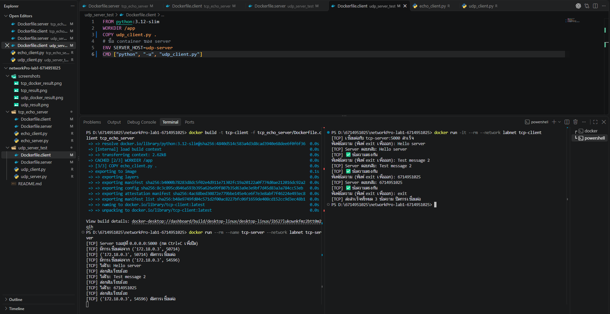
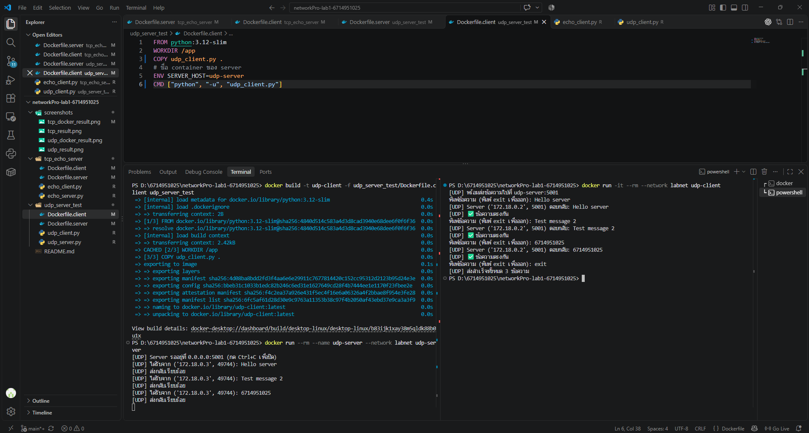

# รายงานผลการทดลอง: Network Programming Lab 1

### ข้อมูลผู้จัดทำ
- **ชื่อ-นามสกุล:** นายณฐกร รัมมะมนต์
- **รหัสนักศึกษา:** 6714951025

---

### 🖥️ ผลการทดสอบการส่งข้อความ

#### รูปที่ 1: ภาพหน้าจอ Terminal ตอนทดสอบส่งข้อความระหว่าง Client-Server ของ TCP Echo
Client (container `tcp-client`) ส่งข้อความ 3 ข้อความไปยัง Server (container `tcp-server`) ผ่าน Docker network `labnet` ได้รับข้อความเดิมกลับมาครบทุกข้อความ



#### รูปที่ 2: ภาพหน้าจอ Terminal ตอนทดสอบส่งข้อความระหว่าง Client-Server ของ UDP Echo
Client (container `udp-client`) ส่งข้อความ 3 ข้อความไปยัง Server (container `udp-server`) ผ่าน UDP โดย Server แสดงข้อความที่ได้รับทุกข้อความและส่งกลับครบ



#### สรุปผล
| การทดสอบ | จำนวนข้อความที่ส่ง | ผลลัพธ์ |
|---|---|---|
| TCP Echo | 3 | ✅ ได้รับกลับครบ ตรงกันทุกข้อความ |
| UDP Echo | 3 | ✅ ได้รับกลับครบ ตรงกันทุกข้อความ |

---

### 📂 โครงสร้าง Repository

```text
networkPro-lab1-6714951025/
├── README.md
├── .gitignore
├── screenshots/
│   ├── tcp_docker_result.png
│   └── udp_docker_result.png
├── tcp_echo_server/          # งานส่วนที่ 1 (TCP)
│   ├── echo_server.py
│   ├── echo_client.py
│   ├── Dockerfile.server
│   └── Dockerfile.client
└── udp_server_test/          # แบบฝึกหัดที่ 1 (UDP)
    ├── udp_server.py
    ├── udp_client.py
    ├── Dockerfile.server
    └── Dockerfile.client
```

---

### 🚀 วิธีดาวน์โหลดและรัน

```bash
git clone https://github.com/6714951025/networkPro-lab1-6714951025.git
cd networkPro-lab1-6714951025
```

#### แบบที่ 1: รันด้วย Docker (ต้องเปิด Docker Desktop ก่อน)

```bash
# สร้าง Docker network ให้ container คุยกันได้ (ทำครั้งเดียว)
docker network create labnet
```

**TCP Echo**
```bash
docker build -t tcp-server -f tcp_echo_server/Dockerfile.server tcp_echo_server
docker build -t tcp-client -f tcp_echo_server/Dockerfile.client tcp_echo_server

# Terminal ที่ 1: เปิด server
docker run --rm --name tcp-server --network labnet tcp-server

# Terminal ที่ 2: เปิด client (พิมพ์ข้อความ แล้วพิมพ์ exit เพื่อออก)
docker run -it --rm --network labnet tcp-client

# ปิด server
docker stop tcp-server
```

**UDP Echo**
```bash
docker build -t udp-server -f udp_server_test/Dockerfile.server udp_server_test
docker build -t udp-client -f udp_server_test/Dockerfile.client udp_server_test

# Terminal ที่ 1: เปิด server
docker run --rm --name udp-server --network labnet udp-server

# Terminal ที่ 2: เปิด client (พิมพ์ข้อความ แล้วพิมพ์ exit เพื่อออก)
docker run -it --rm --network labnet udp-client

# ปิด server
docker stop udp-server
```

#### แบบที่ 2: รันด้วย Python โดยตรง (ไม่ใช้ Docker)

```bash
# TCP
python tcp_echo_server/echo_server.py    # Terminal ที่ 1
python tcp_echo_server/echo_client.py    # Terminal ที่ 2

# UDP
python udp_server_test/udp_server.py     # Terminal ที่ 1
python udp_server_test/udp_client.py     # Terminal ที่ 2
```

---

### 🛠️ การเลือกใช้เทคนิคและเครื่องมือ

| หัวข้อ | TCP | UDP |
|---|---|---|
| ชนิด socket | `SOCK_STREAM` | `SOCK_DGRAM` |
| ต้องเชื่อมต่อก่อนส่ง | ต้อง (`connect` / `accept`) | ไม่ต้อง |
| คำสั่งส่ง / รับ | `sendall` / `recv` | `sendto` / `recvfrom` |
| การรับประกันข้อมูล | รับประกันว่าถึงครบและเรียงลำดับ | ไม่รับประกัน |
| เหมาะกับ | งานที่ข้อมูลต้องครบ เช่น เว็บ, ไฟล์ | งานที่ต้องการความเร็ว เช่น เกม, สตรีมมิ่ง |

**เหตุผลที่เลือก:**
- **Python** มีโมดูล `socket` ในตัว ไม่ต้องติดตั้ง library เพิ่ม โค้ดสั้นและอ่านง่าย
- **TCP** ใช้กับ Echo Server เพราะต้องการให้ข้อความกลับมาครบและถูกต้อง
- **UDP** ไม่มีการเชื่อมต่อ จึงตั้ง `settimeout(5)` ไว้ ถ้าข้อความหายโปรแกรมจะแจ้งเตือนและส่งข้อความถัดไปได้ ไม่ค้าง
- **Docker** แยก server และ client ไว้คนละ container เพื่อจำลองการสื่อสารข้ามเครื่องจริง และรันได้เหมือนกันทุกเครื่อง
- **Docker network** (`labnet`) ให้ client เรียก server ด้วยชื่อ container (`tcp-server`, `udp-server`) ผ่าน DNS ภายในของ Docker
- โค้ดอ่าน IP จาก environment variable (`HOST`, `SERVER_HOST`) จึงรันได้ทั้งใน Docker และบนเครื่องปกติ (`127.0.0.1`) โดยไม่ต้องแก้โค้ด
- Client ตรวจว่าข้อความที่ได้กลับมาตรงกับที่ส่งไป และสรุปจำนวนข้อความที่สำเร็จ เพื่อยืนยันผลการทดสอบ

---

### 📚 แหล่งอ้างอิง
1. คู่มือปฏิบัติการ Python Network Chapter 1 รายวิชา Network Programming
2. Python Software Foundation. *socket — Low-level networking interface.* https://docs.python.org/3/library/socket.html
3. Python Software Foundation. *Socket Programming HOWTO.* https://docs.python.org/3/howto/sockets.html
4. Docker Documentation. *Dockerfile reference.* https://docs.docker.com/reference/dockerfile/
5. Docker Documentation. *Networking overview.* https://docs.docker.com/engine/network/
6. Git Documentation. *git clone.* https://git-scm.com/docs/git-clone